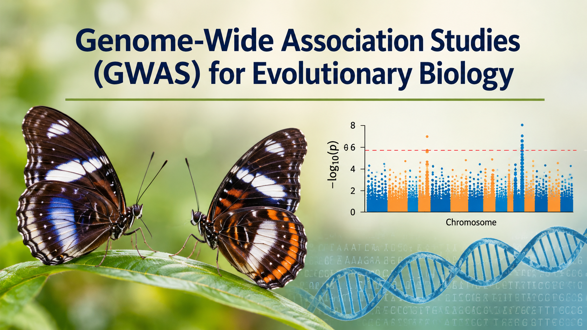

# Genome-Wide Association Studies (GWAS) for Evolutionary Biology

## Instructor

- Dr. Nikolay Oskolkov, Group Leader (PI) at NIRI, Riga, Latvia

## Course overview

Genome-Wide Association Studies (GWAS) have become a cornerstone of modern genetics, enabling researchers to identify genetic variants associated with complex traits, disease, adaptation, and evolutionary processes. Large-scale genotyping and sequencing projects now make it possible to investigate the genetic architecture of phenotypic variation across populations and species. This course provides a practical introduction to GWAS methodology, from data generation and quality control through association testing, meta-analysis, and polygenic prediction.

Participants will learn how to process and analyze genome-wide genotype data, run association studies with widely used software (PLINK, SNPTEST, GWAMA, METAL), visualize and interpret the results, and build polygenic risk scores. The course also covers modern genomic data processing with GATK, population structure correction, and the open problem of missing heritability. Through worked examples on real datasets, you will gain the skills to design, run, and critically evaluate GWAS analyses in evolutionary biology and related fields.

## Target audience and assumed background

The course is intended for evolutionary biologists, population geneticists, bioinformaticians, medical geneticists, quantitative biologists, postgraduate students, and early-career researchers interested in GWAS and complex trait genetics. We assume a basic understanding of genetics, molecular biology, and statistics, and some familiarity with the command line and R. Prior experience with genomic datasets, population genetics, or NGS data is helpful but not required.

## Learning outcomes

By completing this course, you will:

- Understand the principles of genetic variation and genome-wide association studies
- Know the goals and contributions of major reference resources: HapMap, 1000 Genomes, HGDP, and ERGA
- Be able to phase and impute genotype data with PHASEIT2 and IMPUTE2
- Apply best-practice genotype QC: Hardy-Weinberg equilibrium, SNP call rate, and minor allele frequency/count filters
- Perform association testing with PLINK and SNPTEST, and meta-analysis with GWAMA and METAL
- Process NGS data with GATK best practices, from alignment and base quality recalibration to variant calling with HaplotypeCaller
- Carry out permutation testing and conditional association analyses, and parallelize large GWAS computations
- Visualize results with Manhattan plots and LocusZoom, and correct for population structure using PCA
- Construct and validate polygenic risk scores on independent datasets
- Understand the missing heritability problem and current approaches to addressing it 

---

# Schedule

## Before the course

| Time   | Activity                                                                                           |Link                                                                                                            |
|--------|----------------------------------------------------------------------------------------------------|------------------------------------------------------------------------------------------------------------------------------------------|
| ~ 1 h  | Recorded talk: PMNET Precision Medicine Forum 2025                                                 | [Video](https://www.youtube.com/watch?v=aht-VdLw6gs)                                                                                                      |
| ~ 2 h  | Identifying genetic variation associated with schizophrenia in cohorts of Swedish individuals      | [PDF](https://github.com/NikolayOskolkov/GWAS/tree/main/articles/s41467-020-15707-w.pdf)                                                                                                        |
| ~ 2 h  | Genetic variation association with human skeletal muscle capillary density and endurance sports    | [PDF](https://github.com/NikolayOskolkov/GWAS/tree/main/articles/PIIS2211124726000392.pdf)                                                                                     |
| ~ 1 h  | Useful reading: how the curse of dimensionality complicates genomics analysis                      | [Blog](https://medium.com/data-science/genomics-new-clothes-6301ab9798a7?sk=db5db53c7f968add8a4b9a82579bf56d)                                                                          |
| ~ 1 h  | In case needed: Recap on basic Unix commands                                                       | [Lab](https://github.com/NikolayOskolkov/PopGen_PopStructure/tree/main/practicals/command-line-basics.md)                                                                                                    |

## Day 1: 3 pm - 9 pm Swedish time

| Time           | Activity                                                                                   |Link                                                                                                            |
|----------------|--------------------------------------------------------------------------------------------|------------------------------------------------------------------------------------------------------------------------------------------|
| 15.00 - 16.00  | Course outline and practical information, introductions of instructor and participants     | [Slides](https://github.com/NikolayOskolkov/GWAS/tree/main/slides/Day1/course_outline.pdf)                                                                                           |
| 16.00 - 17.30  | Introduction to genetic variation, GWAS and available large-scale genomic resources        | [Slides](https://github.com/NikolayOskolkov/GWAS/tree/main/slides/Day1/GWAS_genetic_variation_reference_resources.pdf)                                                                                       |
| 17.30 - 18.30  | Break                                                                                      |                                                                                                                |
| 18.30 - 19.30  | Practical: quality control, adapter removal and alignment of 1000G genomics data           | [Lab](https://html-preview.github.io/?url=https://github.com/NikolayOskolkov/GWAS/blob/main/practicals/Day1/QC_Alignment_1000G_Colab.html)                                                                                |
| 18.30 - 19.30  | Practical: quality control, adapter removal and alignment of Hypolimnas misippus genomics  | [Lab](https://html-preview.github.io/?url=https://github.com/NikolayOskolkov/GWAS/blob/main/practicals/Day1/QC_Alignment_Hypolimnas_misippus_Colab.html)                                                                  |
| 19.30 - 20.00  | Imputation strategies for chip-genotyping data to increase resolution of GWAS              | [Slides](https://github.com/NikolayOskolkov/GWAS/tree/main/slides/Day1/imputation.pdf)                                                                                               |
| 20.00 - 20.30  | Practical: phasing and imputation of chromosome 22 in 1000G genomics data                  | [Lab](https://html-preview.github.io/?url=https://github.com/NikolayOskolkov/GWAS/blob/main/practicals/Day1/Phasing_Imputation_SHAPEIT2_IMPUTE2_1000G_chr22_Colab.html)                                                   |
| 20.30 - 21.00  | Questions and discussion                                                                   |

## Day 2: 3 pm - 9 pm Swedish time

| Time           | Activity                                                                                   |Link                                                                                                            |
|----------------|--------------------------------------------------------------------------------------------|------------------------------------------------------------------------------------------------------------------------------------------|
| 15.00 - 16.00  | Challenges of high-dimensional genomics data analysis and genome-wide association studies  | [Slides](https://github.com/NikolayOskolkov/GWAS/tree/main/slides/Day1/ChallengesGenomics.pdf)                                                                                       |
| 16.00 - 17.30  | Probabilistic genetic variation identification from low-coverage genomics data with ANGSD  | [Slides](https://github.com/NikolayOskolkov/GWAS/tree/main/slides/Day2/ANGSD.pdf)                                                                                                    |
| 17.30 - 18.30  | Break                                                                                      |                                                                                                                |
| 18.30 - 19.30  | Practical: variant calling from low-coverage genomics data with ANGSD                      | [Lab](https://html-preview.github.io/?url=https://github.com/NikolayOskolkov/GWAS/blob/main/practicals/Day2/ANGSD_Lab_GoogleColab.html)                                                                                   |
| 19.30 - 20.30  | Practical: variant filtering and association analysis with ANGSD, PLINK and SNPTEST        | [Lab](https://github.com/NikolayOskolkov/GWAS/blob/main/practicals/Day2/Association_ANGSD_PLINK_SNPTEST_Hypolimnas_misippus_Colab.ipynb)                                              |
| 20.30 - 21.00  | Questions and discussion                                                                   |

## Day 3: 3 pm - 9 pm Swedish time

| Time           | Activity                                                                                   |Link                                                                                                            |
|----------------|--------------------------------------------------------------------------------------------|------------------------------------------------------------------------------------------------------------------------------------------|
| 15.00 - 17.30  | Introduction to Next Generation Sequencing (NGS) data, BWA alignment and GATK workflow     | [Slides](https://github.com/NikolayOskolkov/GWAS/tree/main/slides/Day3/NGS_workflow_GATK.pdf)                                                                                        |
| 17.30 - 18.30  | Break                                                                                      |                                                                                                                |
| 18.30 - 19.30  | Genome-Wide Association studies on human skeletal muscle fibertype composition             | [Slides](https://github.com/NikolayOskolkov/GWAS/tree/main/slides/Day2/GWAS.pdf)                                                                                                     |
| 19.30 - 20.30  | Practical: QC and HWE, MAF, call rate etc. filtering of Hypolimnas misippus data           | [Lab](https://html-preview.github.io/?url=https://github.com/NikolayOskolkov/GWAS/blob/main/practicals/Day2/QC_Filtering_HWE_Hypolimnas_misippus_Colab.html)                                                             |
| 19.30 - 20.30  | Practical: variant calling with GATK workflow using Hypolimnas misippus genomics data      | [Lab](https://html-preview.github.io/?url=https://github.com/NikolayOskolkov/GWAS/blob/main/practicals/Day3/Variant_Calling_GATK_Hypolimnas_misippus_Colab.html)                                                          |
| 20.30 - 21.00  | Questions and discussion                                                                   |

## Day 4: 3 pm - 9 pm Swedish time

| Time           | Activity                                                                                   |Link                                                                                                            |
|----------------|--------------------------------------------------------------------------------------------|------------------------------------------------------------------------------------------------------------------------------------------|
| 15.00 - 16.00  | Principal Components Analysis (PCA) for population genomics applications                   | [Slides](https://github.com/NikolayOskolkov/PopGen_PopStructure/tree/main/slides/Day2/PCA_PopGen.pdf)                                                                                               |
| 16.00 - 17.30  | GWAS meta-analysis (fixed vs. random effects) with GWAMA and METAL                         | [Slides](https://github.com/NikolayOskolkov/GWAS/tree/main/slides/Day4/GWAS_Meta_Analysis_GWAMA_METAL.pdf)                                                                           |
| 17.30 - 18.30  | Break                                                                                      |                                                                                                                |
| 18.30 - 19.30  | Practical: coding PCA and Multi-Dimensional Scaling (MDS) from scratch                     | [Lab](https://html-preview.github.io/?url=https://github.com/NikolayOskolkov/PopGen_PopStructure/tree/main/practicals/Day2/pca_mds_toy_example.html)                                                                     |
| 18.30 - 19.30  | Practical: practicing PCA, MDS, tSNE and UMAP                                              | [Lab](https://html-preview.github.io/?url=https://github.com/NikolayOskolkov/PopGen_PopStructure/tree/main/practicals/Day2/Dimension_Reduction_tutorial.html)                                                            |
| 19.30 - 20.30  | Practical: horseshoue effect in PCA, coding from scratch and exploring block structure     | [Lab](https://html-preview.github.io/?url=https://github.com/NikolayOskolkov/PopGen_PopStructure/tree/main/practicals/Day2/WhyPCALooksTriangular.html)                                                                   |
| 20.30 - 21.00  | Questions and discussion                                                                   |

## Day 5: 3 pm - 9 pm Swedish time

| Time           | Activity                                                                                   |Link                                                                                                            |
|----------------|--------------------------------------------------------------------------------------------|------------------------------------------------------------------------------------------------------------------------------------------|
| 15.00 - 17.30  | Polygenic Risk Scores prediction on independent sample and Missing Heritability problem    | [Slides](https://github.com/NikolayOskolkov/GWAS/tree/main/slides/Day5/PolygenicRiskScores.pdf)                                                                                        |
| 17.30 - 18.30  | Break                                                                                      |                                                                                                                |
| 18.30 - 20.30  | Practical: variant calling from low-coverage genomics data with ANGSD                      | [Lab](https://html-preview.github.io/?url=https://github.com/NikolayOskolkov/PopGen_PopStructure/tree/main/practicals/Day1/ANGSD_Lab_GoogleColab.html)                                                                   |
| 20.30 - 21.00  | Questions and discussion                                                                   |
